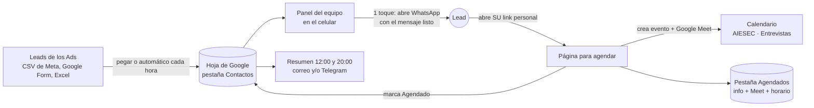

# 📲 Contacto de leads → agenda automática → resumen diario

Automatización para que el equipo de AIESEC contacte por WhatsApp a las personas que llegan de los Ads, que **cada una agende sola** su reunión, y que el equipo reciba **a las 12:00 y a las 20:00** quién agendó.

Todo corre gratis dentro de Google (Hojas de cálculo + Apps Script + Calendar + Meet). No hay servidores, ni suscripciones, ni nada que instalar.



## Qué hace

| Necesidad | Cómo queda resuelta |
|---|---|
| Contactar ~94 personas (y las que lleguen) | **Panel** con "Modo rápido": muestra a la siguiente persona, un toque abre WhatsApp con el mensaje personalizado (nombre + link propio), y pasa a la siguiente. Varias personas del equipo pueden trabajar a la vez sin escribirle dos veces a la misma. |
| Mensajes y posibles respuestas | Pestaña **Mensajes**: 1er mensaje, seguimiento, recordatorio y todas las respuestas rápidas que quieran (`RESP_…`). Se usan desde el panel con un toque. |
| Saber a quién ya se contactó | Pestaña **Contactos** con estado (Pendiente → Contactado → Respondió → Agendado → Asistió…), quién lo contactó, cuántos mensajes y cuándo. Se actualiza solo al usar el panel. |
| Google Calendar aparte | Se crea un calendario **"AIESEC · Entrevistas"** separado de tu calendario personal (lo puedes ocultar o mostrar con un clic). Opcionalmente revisa tu calendario personal para no ofrecer horarios en los que estás ocupado, **sin mezclar eventos**. |
| Info de cada aplicante, su link de reunión y el horario | Pestaña **Agendados**: fecha, nombre, WhatsApp, correo, link de Google Meet, quién lo contactó, y columnas para que el entrevistador marque **Resultado** y notas. |
| Avisos al mediodía y 8 p. m. | Correo (y Telegram si lo conectan) con: nuevos agendados, reuniones de hoy y mañana (con botón de **recordatorio por WhatsApp**), cómo va el embudo y a quién hacerle seguimiento. |

Extras incluidos: festivos de Colombia bloqueados, cupos simultáneos (si entrevistan dos personas a la vez), reprogramar/cancelar desde el mismo link, importación automática desde otra hoja (Google Form o Zapier), aviso instantáneo opcional y envío 100 % automático por **WhatsApp Cloud API** (opcional, ver abajo).

## ¿Por qué WhatsApp va "a un toque" y no 100 % automático?

Claude no puede conectarse directamente a WhatsApp, y la única forma oficial de mandar mensajes automáticos a personas que no te han escrito es la **WhatsApp Cloud API de Meta** (plantillas aprobadas, número dedicado, pago por mensaje). Las herramientas "no oficiales" de envío masivo violan los términos de WhatsApp y pueden **bloquear el número de AIESEC**.

Por eso el sistema tiene dos niveles:

- **Nivel 1 (recomendado para arrancar hoy, gratis):** WhatsApp Business del comité + panel. Un toque por persona (~10 s). Todo lo demás (agendar, calendario, Meet, hoja, resúmenes) es automático.
- **Nivel 2 (opcional, 100 % automático):** WhatsApp Cloud API. Envía la invitación a todos los pendientes de una vez (y a los nuevos cada hora). Cuesta ~USD 0,014 por invitación en Colombia (≈ USD 1,4 por 94) y requiere configurar Meta Business. Ya está programado; solo hay que poner credenciales. → [docs/whatsapp-api.md](docs/whatsapp-api.md)

Comparación completa de opciones, costos y fuentes: [docs/opciones-whatsapp.md](docs/opciones-whatsapp.md).

## Instalación (≈ 20 minutos, una sola vez)

> Hazlo con la cuenta de Google en la que quieres el calendario. **Ojo:** las cuentas universitarias (ej. `@udea.edu.co`) a veces no dejan publicar apps para "Cualquier usuario"; si te pasa, usa una cuenta `@gmail.com` (la tuya o una del comité) y comparte el calendario con tu cuenta principal.

1. **Crea la hoja.** Abre [sheets.new](https://sheets.new) y ponle nombre (ej. *AIESEC · Leads Ads*).
2. **Abre el editor de código.** En la hoja: *Extensiones → Apps Script*.
3. **Muestra el manifiesto.** En Apps Script: ⚙️ *Configuración del proyecto* → marca *"Mostrar el archivo de manifiesto «appsscript.json» en el editor"*.
4. **Pega los 4 archivos de la carpeta [`dist/`](dist/)** (vuelve a *Editor* `< >`):
   - `Código.gs` → borra lo que tenga y pega todo [`dist/Codigo.gs`](dist/Codigo.gs).
   - `appsscript.json` → reemplázalo por [`dist/appsscript.json`](dist/appsscript.json).
   - Botón **+** → *HTML* → nómbralo `Agendar` → pega [`dist/Agendar.html`](dist/Agendar.html).
   - Botón **+** → *HTML* → nómbralo `Panel` → pega [`dist/Panel.html`](dist/Panel.html).
   - Guarda (Ctrl/Cmd + S).
5. **Configura.** Vuelve a la hoja y recárgala. Aparece el menú **🌍 AIESEC** → *⚙️ Configurar / reparar*. Google pedirá permisos: elige tu cuenta → *"Google no verificó esta app"* → *Configuración avanzada* → *Ir a … (no seguro)* → *Permitir*. (Sale ese aviso porque es **tu propio** script, no una app publicada.) Esto crea las pestañas, el calendario **AIESEC · Entrevistas** y los resúmenes de las 12:00 y 20:00.
6. **Publica la página de agendamiento.** En Apps Script: *Implementar → Nueva implementación* → ⚙️ *Aplicación web* → *Ejecutar como:* **Yo** → *Quién tiene acceso:* **Cualquier usuario** → *Implementar*. Copia la URL que termina en `/exec`.
7. **Pega la URL** en la pestaña **Config** → *URL de la app web*. Luego menú **🌍 AIESEC → 🔗 Ver links**: ahí está el **link del panel** para compartir con el equipo.
8. **Personaliza** en la pestaña **Config**: nombres del equipo, correos que reciben el resumen, correos de quienes entrevistan, duración, horarios por día, etc.
9. **Escribe tus mensajes** en la pestaña **Mensajes** (vienen ejemplos). Variables disponibles: `{primer_nombre}` `{nombre}` `{link}` `{remitente}` `{organizacion}` `{fecha_reunion}` `{hora_reunion}` `{meet}`.
10. **Carga los leads**: pega el export de los Ads (con la fila de encabezados) en la pestaña **Importar** → menú *📥 Importar*. Detecta solo las columnas de nombre, teléfono y correo (sirve el CSV de Meta Lead Ads, Google Forms, Excel…), normaliza los números (+57) y no duplica.

**¿Actualizar el código después?** Pega los archivos nuevos y luego *Implementar → Gestionar implementaciones → ✏️ → Versión: Nueva versión → Implementar*. Así **la URL no cambia** y los links que ya enviaron siguen funcionando.

¿Prefieres la terminal? Con [clasp](https://github.com/google/clasp): `npm i -g @google/clasp && clasp login`, copia `.clasp.json.example` a `.clasp.json` con el ID de tu script y corre `npm run push`.

## Uso diario

Guía de una página para el equipo: **[docs/guia-equipo.md](docs/guia-equipo.md)**. Resumen:

1. Abre el **link del panel** en el celular y elige *¿Quién eres?*.
2. Toca **⚡ Modo rápido** → *Abrir WhatsApp y enviar* → envía → vuelve al panel → siguiente.
3. Cuando alguien responda, márcalo *Respondió* y usa **💬 Responder** para mandar la respuesta rápida que toque.
4. Ellos agendan solos con su link. La reunión aparece en el calendario **AIESEC · Entrevistas**, con Meet, y en la pestaña **Agendados**.
5. A las **12:00** y **20:00** llega el resumen. El de la noche trae botones para mandar el **recordatorio** a quienes tienen reunión mañana.
6. Después de cada entrevista, marca **Resultado** en *Agendados* (Asistió / No asistió) y el estado del lead se actualiza solo.

## Avisos por Telegram (opcional, 2 minutos)

Si quieres que el resumen llegue como notificación al celular, además del correo: menú **🌍 AIESEC → 🔔 Avisos por Telegram → Conectar**. Te guía para crear un bot con @BotFather y lo conecta solo (puede ser tu chat o un grupo del equipo). Con *Avisar al instante = SI* en Config, también avisa apenas alguien agenda.

## Estructura

```
contacto-leads/
├── dist/                 ← los 4 archivos para pegar en Apps Script (generados)
├── src/
│   ├── 00_Config.js      ← pestañas, columnas, estados y parámetros de Config
│   ├── 01_Utilidades.js  ← teléfonos, fechas en español, festivos, cálculo de horarios
│   ├── 02_Hoja.js        ← lectura/escritura de la hoja
│   ├── 03_Leads.js       ← importación inteligente de leads
│   ├── 04_Agenda.js      ← disponibilidad, reservas, Google Calendar + Meet
│   ├── 05_Panel.js       ← funciones del panel (protegidas con clave)
│   ├── 06_Reportes.js    ← resúmenes 12:00/20:00, Telegram
│   ├── 07_WhatsAppAPI.js ← envío por WhatsApp Cloud API (opcional)
│   ├── 08_WebApp.js      ← doGet: página de agendamiento y panel
│   ├── 09_Menu.js        ← menú, configuración inicial, disparadores
│   ├── Agendar.html      ← página que ve el aplicante
│   └── Panel.html        ← panel del equipo
├── tests/                ← 30 pruebas con un simulador de Google (node --test)
└── docs/
```

Desarrollo: `npm test` (genera `dist/` y corre las pruebas; necesita Node 18+). Edita siempre en `src/` y vuelve a generar `dist/`.

## Seguridad y datos personales

- Son datos personales de los leads (Ley 1581 de 2012 – Habeas Data): comparte la hoja **solo** con el equipo y no publiques el link del panel. Si se filtra, usa *🔑 Cambiar la clave del panel*.
- La página de agendamiento solo muestra horarios; cada aplicante solo ve su propia reserva (su link tiene un código aleatorio).
- Las funciones del menú y los disparadores no se pueden ejecutar desde la página web. Las credenciales (WhatsApp API, Telegram) se guardan en las propiedades del script, no en la hoja.
- Solo la cuenta que configuró la primera vez puede usar *Configurar* (el calendario y los avisos viven en su cuenta).

## Problemas comunes

[docs/problemas-comunes.md](docs/problemas-comunes.md)
